# 🎬 Movie Industry Analysis 2024–2026


> A full-stack data analytics project exploring **916 movies released between 2024 and 2026**
> box office economics, genre strategy, studio power rankings, release timing and audience
> ratings analyzed end-to-end with **Python (EDA + 16 charts)**, **PostgreSQL (17 queries)**
> and **Power BI (interactive dashboard)**.

<p align="center">
  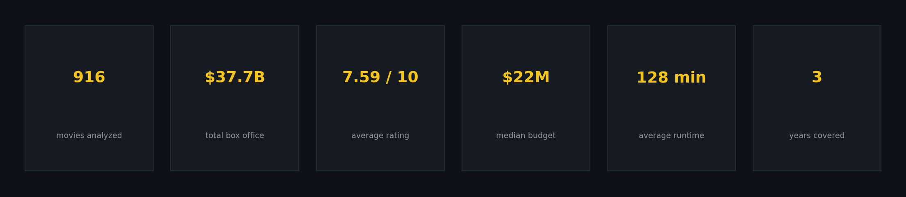
</p>

---

## 📌 Why This Project

Every studio asks the same two questions: *what should we make, and when should we release it?*
This project answers both with data. It combines three analytical layers a reproducible
Python pipeline, a PostgreSQL query suite and a Power BI dashboard into one coherent
story about what actually drives a movie's financial success in the 2024–2026 era.

## 🔑 Key Insights

| # | Finding | Evidence |
|---|---------|----------|
| 1 | **Scale drives revenue, quality doesn't** | Budget↔Box office correlation **r = 0.97**; Rating↔Box office **r = 0.00** |
| 2 | **July is the golden release window** | Avg July release grosses **$83.7M** — 2.8× an August release ($30.1M) |
| 3 | **R-rated films are ROI machines** | Median ROI **+258%** (lean budgets) vs **+30%** for PG-13 tentpoles |
| 4 | **Family genre = revenue per title king** | **$84.8M** avg per Family release, ahead of Action ($60.6M) |
| 5 | **Franchises own the top of the board** | *Descendants: Wicked Wonderland* ($511M), *Avatar Aang* ($509M), *Spider-Man: Brand New Day* ($502M) |
| 6 | **A three-studio oligopoly** | Universal ($3.25B), Walt Disney ($2.69B), Netflix ($2.59B) in total gross |
| 7 | **120–140 min is the money runtime** | Highest average gross of any runtime band |
| 8 | **The market cooled ~8% since 2024** | Total gross: 2024 $13.5B → 2025 $11.8B → 2026 $12.4B |

## 🖼 Chart Gallery (16 visuals · dark cinematic theme)

| | |
|---|---|
| 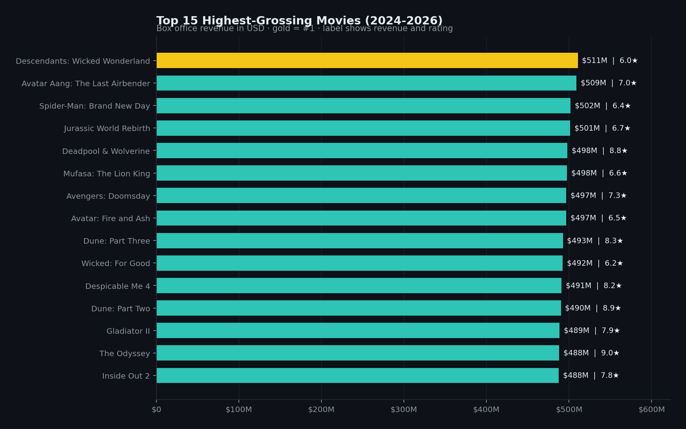 | 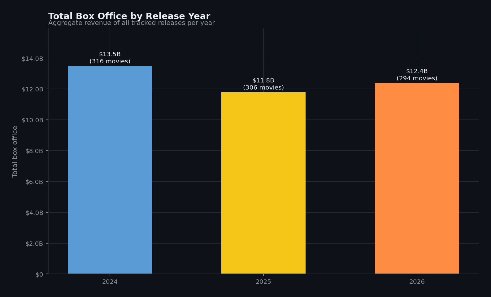 |
| 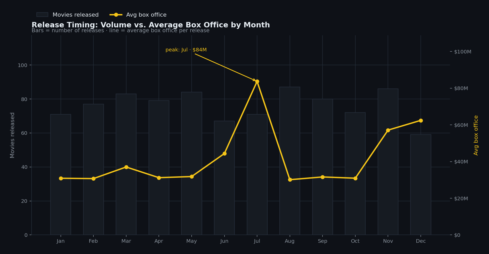 | 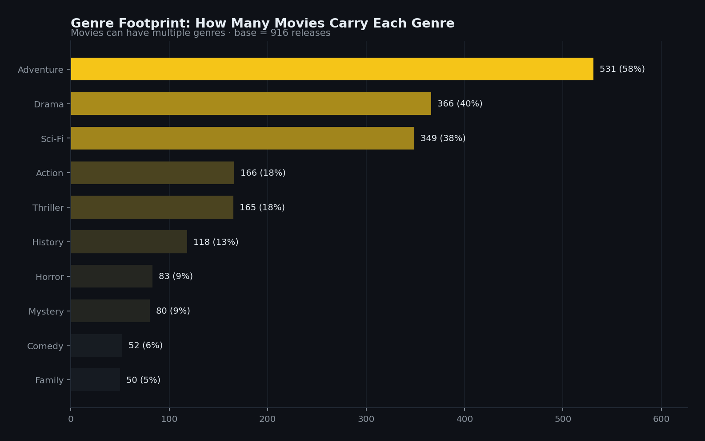 |
| 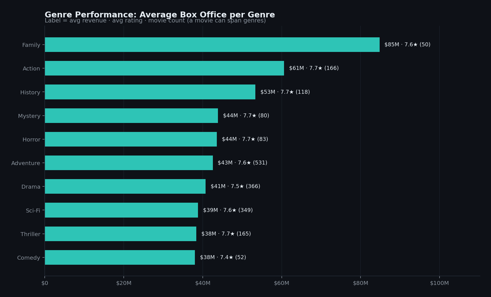 | 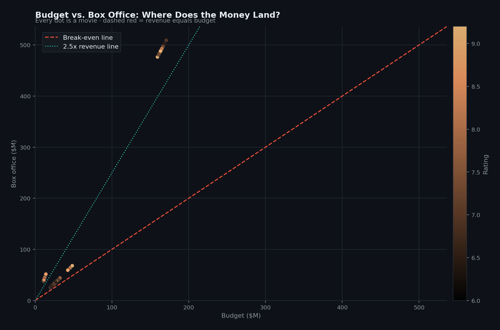 |
| 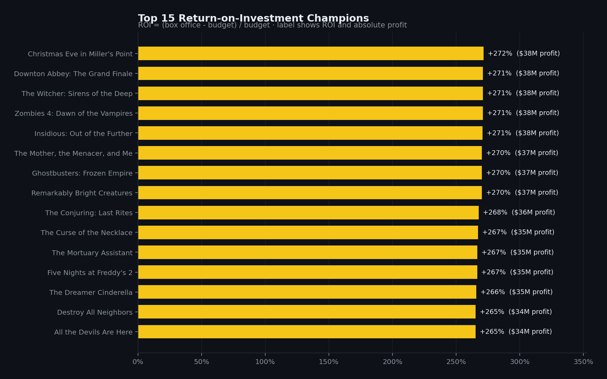 | 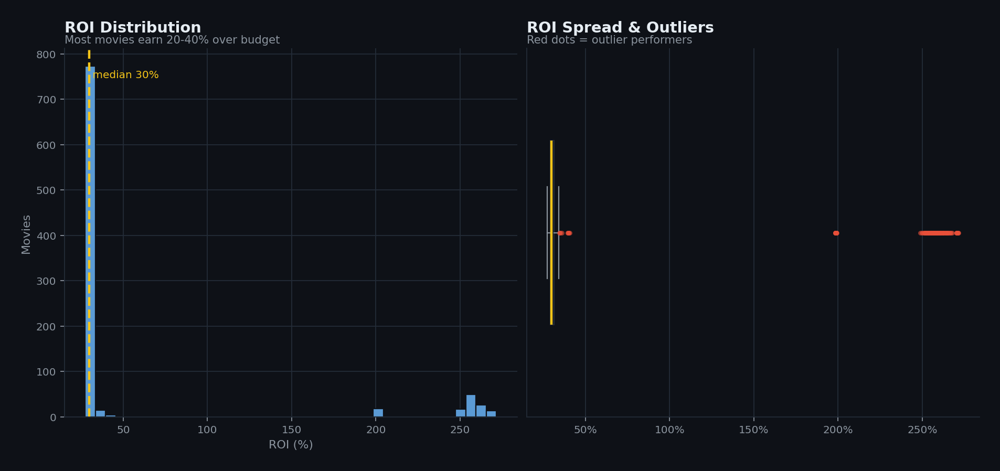 |
| 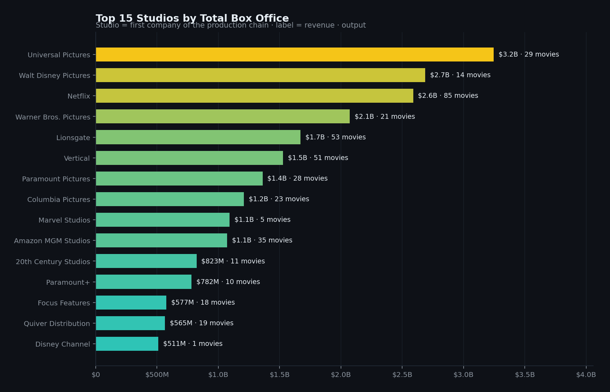 | 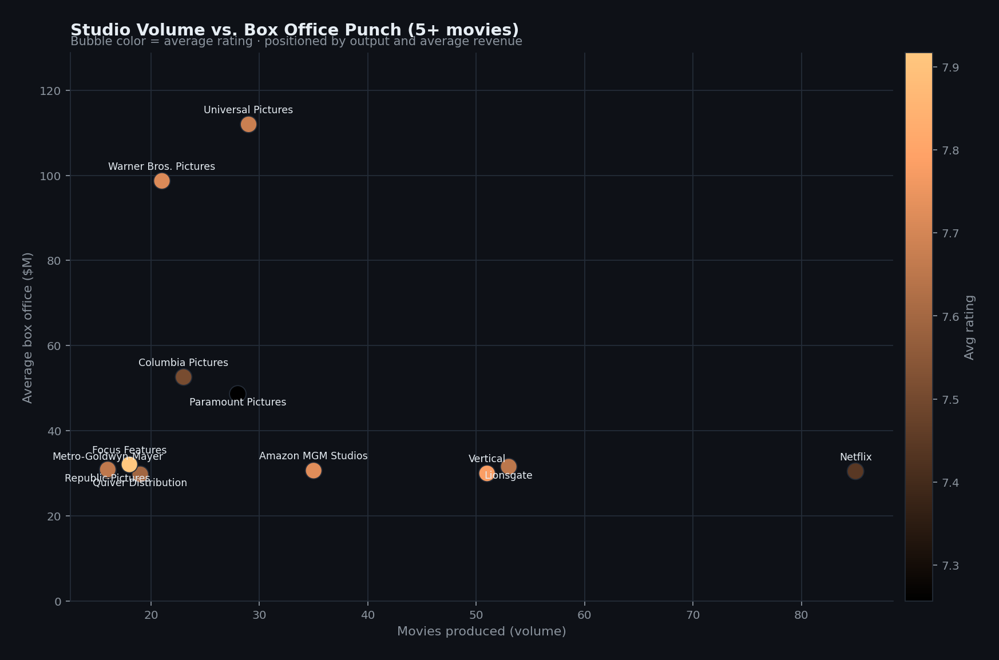 |
| 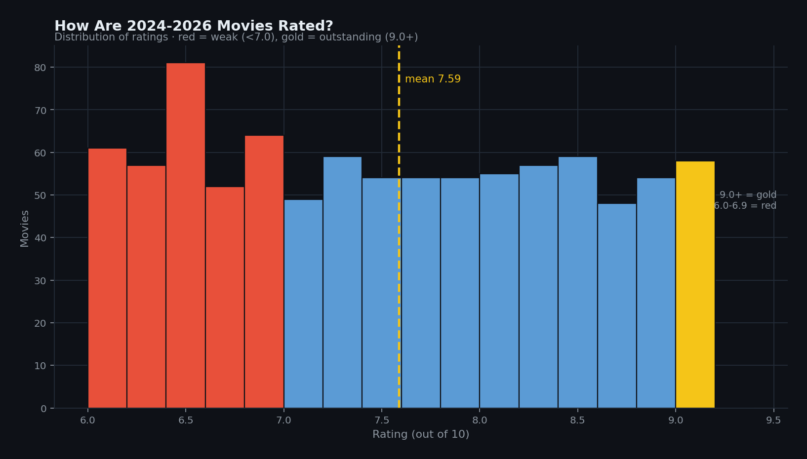 | 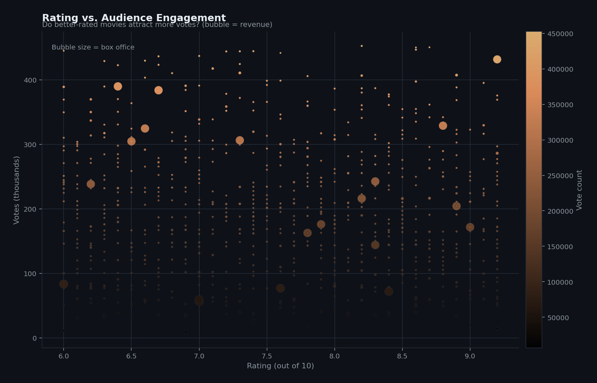 |
| 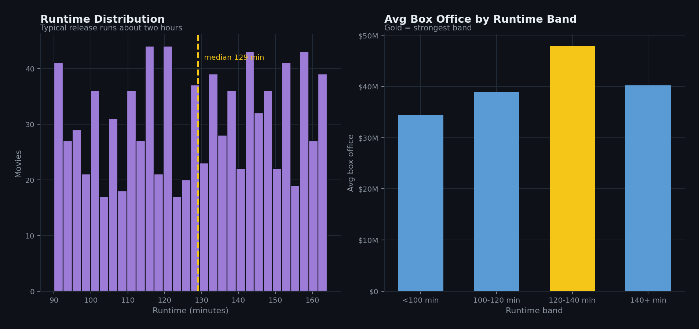 | 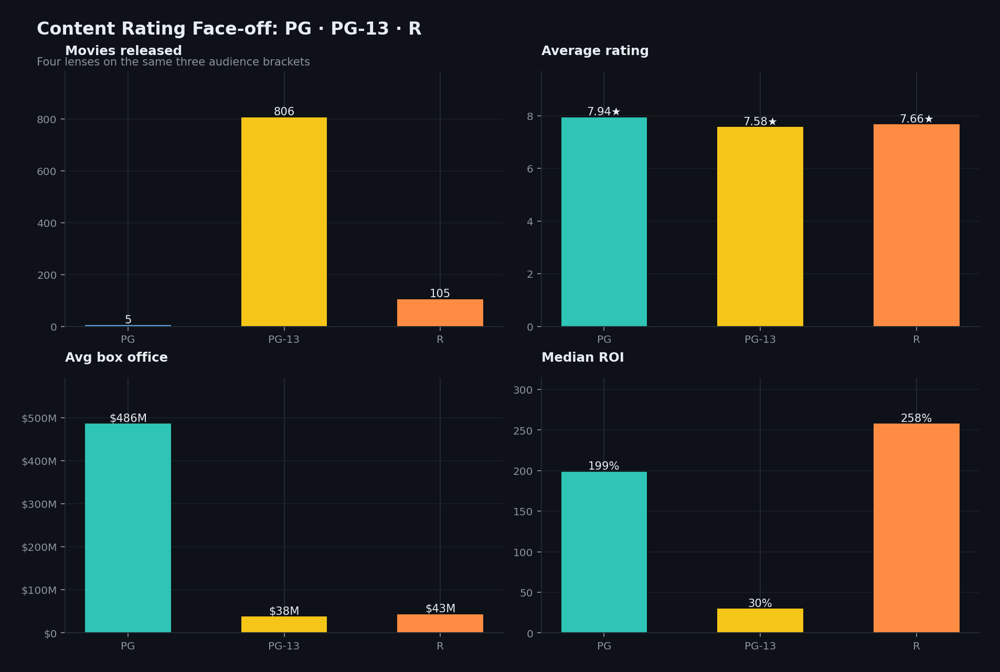 |
| 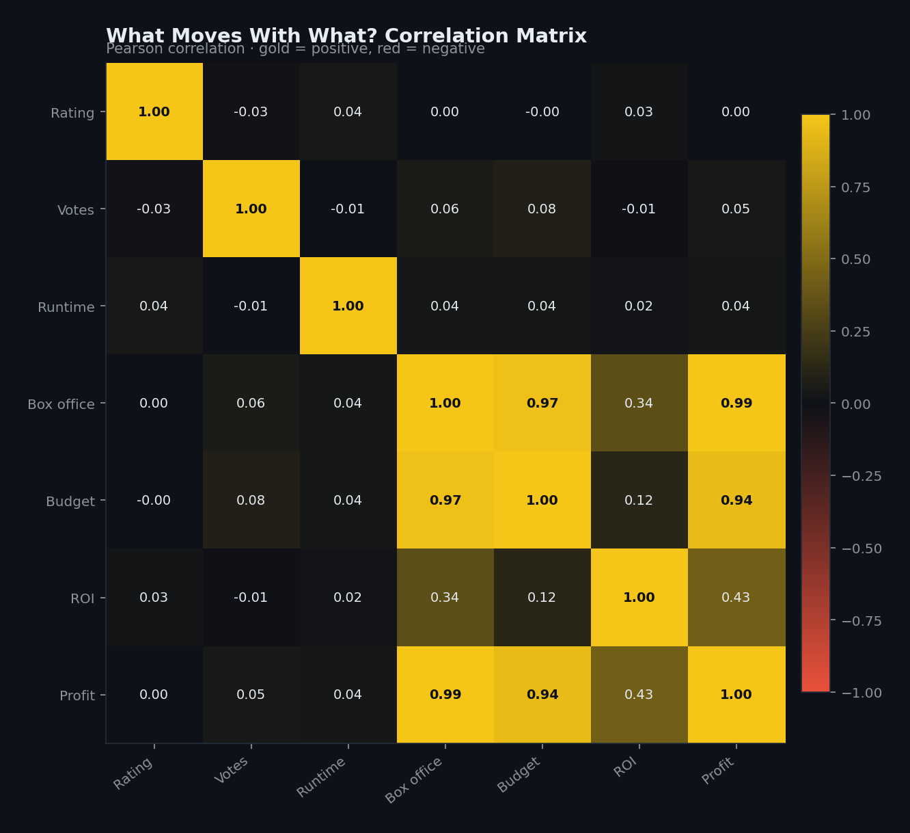 | 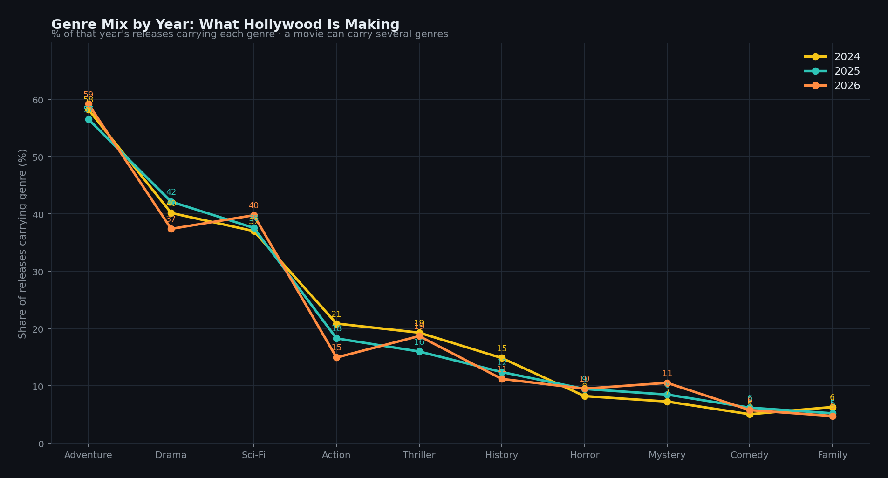 |

## 🗂 Repository Structure

```text
movie-industry-analysis-2024-2026/
├── data/
│   ├── cleaned_movies_2024_2026.csv   # main dataset (916 movies × 31 columns)
│   └── DATA_DICTIONARY.md             # every field explained
├── notebooks/
│   └── 01_exploratory_analysis.ipynb  # full EDA — executed, with narrative
├── src/
│   ├── config.py                      # dark cinematic theme + loaders + helpers
│   └── generate_charts.py             # one-command pipeline → 17 PNGs
├── sql/
│   └── movie_industry_queries.sql     # 17 PostgreSQL analyses (aggregations, window fn)
├── powerbi/
│   └── Movie_Industry_Dashboard.pbix  # interactive 3-page dashboard
├── images/                            # generated chart gallery (dark cinematic)
├── requirements.txt
├── LICENSE
└── README.md
```

## 🛠 Three Analysis Layers

### 1 · Python — reproducible pipeline
```bash
git clone https://github.com/<your-username>/movie-industry-analysis-2024-2026.git
cd movie-industry-analysis-2024-2026
pip install -r requirements.txt

python src/generate_charts.py                          # regenerates all 17 charts
jupyter lab notebooks/01_exploratory_analysis.ipynb    # interactive EDA walkthrough
```
The pipeline is idempotent: `config.py` holds the theme, palette and derived-feature
loader (`roi_pct`, `profit_usd`, `primary_studio`, `runtime_band`); `generate_charts.py`
renders every visual into `images/`.

### 2 · SQL — PostgreSQL query suite
`sql/movie_industry_queries.sql` contains 17 ready-to-run analyses mirroring the Python
findings: descriptive stats, top/bottom box office, ROI ranking, release-month
performance, studio aggregations, PG-13 vs R comparison, per-genre performance
(`UNION ALL` + `FILTER`), a `DENSE_RANK()` window function for each studio's top title,
and a data-quality audit. Load the CSV once:

```sql
\copy cleaned_movies FROM 'data/cleaned_movies_2024_2026.csv' CSV HEADER;
```

### 3 · Power BI — interactive dashboard
`powerbi/Movie_Industry_Dashboard.pbix` (open in Power BI Desktop) includes a movie-level
table, Top-10-studios and revenue-trend pivots, and slicers for year, genre and content
rating useful for slicing the same questions interactively.

## 🧾 Dataset Notes

- **Scope:** 916 U.S., English-language releases, 2024–2026, one row per movie.
- **Financials** are USD; `box_office_usd` and `budget_usd` are complete for all rows.
- **Known quirks (handled):**
  - `director` missing for 305 rows and `release_day` for 676 → treated as "unknown /
    day-1-of-month" and excluded from day-level analysis.
  - 2 titles appear in two different release years (*The Long Game*, *Don't Move*)
    kept deliberately as separate release events.
  - `production_company` strings may chain several studios (`/`-separated); analysis uses
    the **first** company as `primary_studio`.
- In this dataset every tracked release grosses above its budget, so ROI figures describe
  *relative* profitability rather than break-even risk.
- Ratings are community scores on a 0–10 scale (observed range 6.0–9.2).

## 📊 Skills Demonstrated

`pandas` · `numpy` · `matplotlib` custom theming · feature engineering ·
exploratory data analysis · correlation analysis · PostgreSQL (aggregations, `FILTER`,
`UNION ALL`, window functions, data-quality checks) · Power BI modeling & dashboards ·
data storytelling

## 📄 License

Released under the [MIT License](LICENSE).

---

*Built with 🍿 and a dark cinema theme — gold `#F5C518` on theater black `#0E1117`.*
